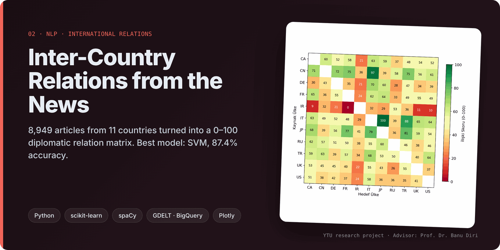
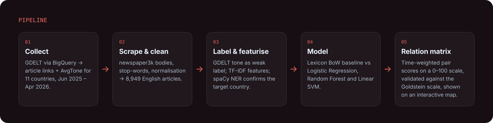
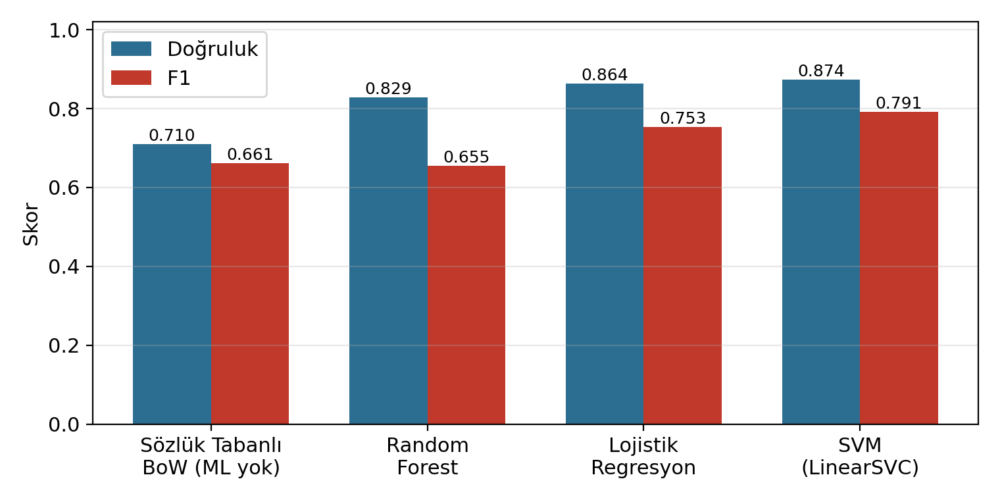
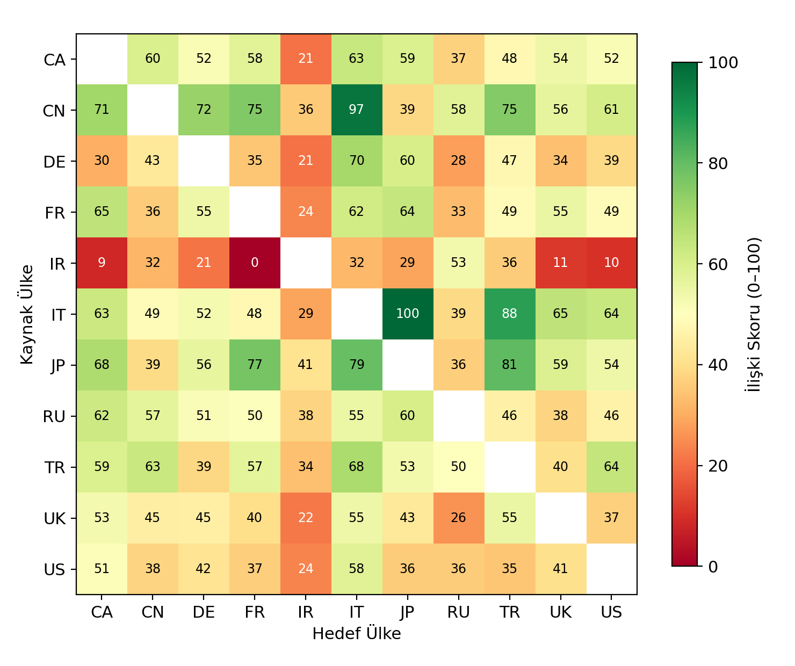
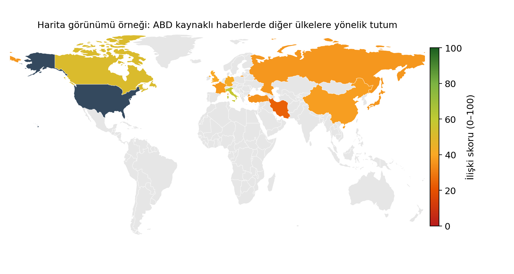
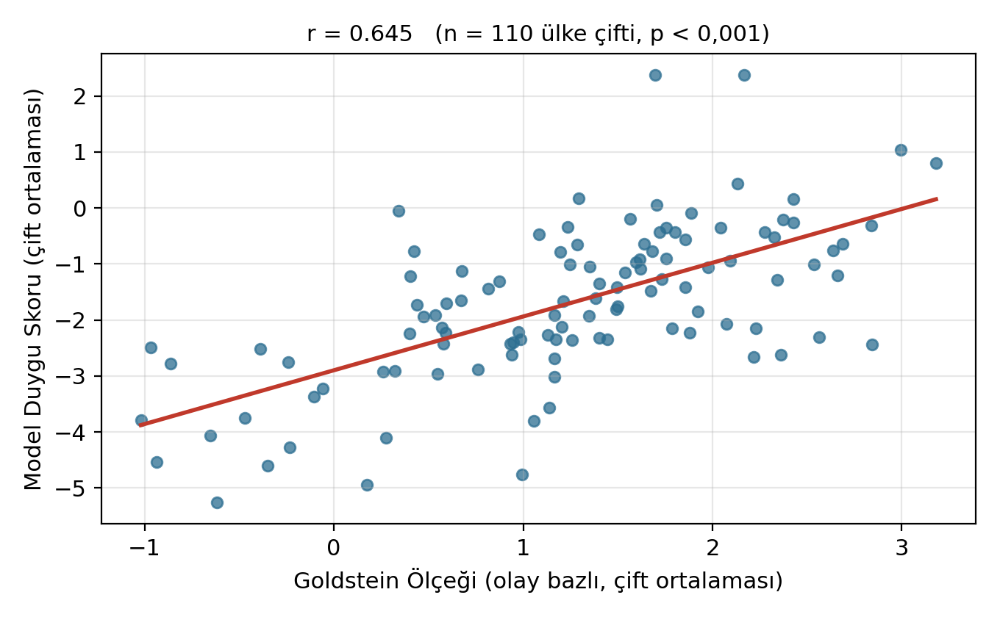
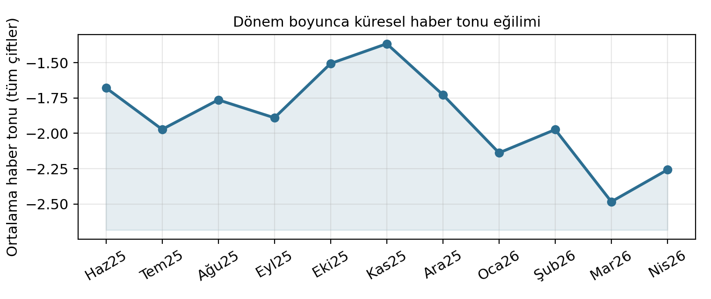
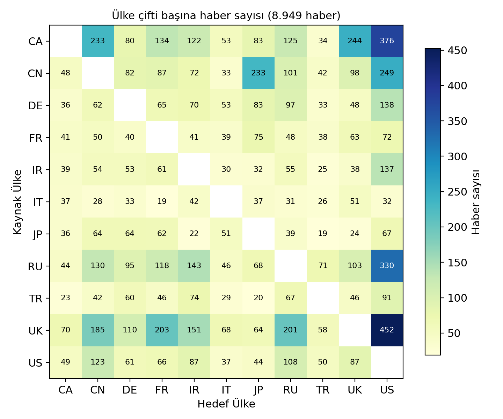
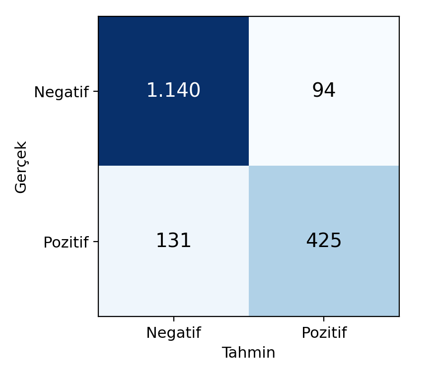

# Analysis of Inter-Country Relations Through News Articles

**YTU Computer Engineering research project** · Advisor: **Prof. Dr. Banu Diri**
📄 Paper: [`paper/Inter-Country_Relations_Article.pdf`](paper/Inter-Country_Relations_Article.pdf)

The project models diplomatic relations between countries **automatically, from international news**, and draws them on an interactive world map.

- **8,949** English-language articles from outlets in **11 countries** (CA, CN, DE, FR, IR, IT, JP, RU, TR, UK, US)
- Time span: **June 2025 to April 2026**, collected from **GDELT** through Google BigQuery
- Output: a **0–100 relation score** for each country pair, checked against the independent **Goldstein event scale**

## Pipeline

## Results

| Model | Accuracy | F1 |
|---|---:|---:|
| Lexicon-based Bag-of-Words (no ML) | 0.710 | 0.661 |
| Random Forest | 0.829 | 0.655 |
| Logistic Regression | 0.864 | 0.753 |
| **Linear SVM** | **0.874** | **0.791** |

### Relation matrix (source → target, 0–100)

### Interactive map

The final notebook exports an interactive Plotly world map. You pick a source country and see its attitude toward every other country.

### Validation and trends

<table>
<tr>
<td width="50%"> Model sentiment vs. the Goldstein scale: <b>r = 0.645</b> (n = 110 country pairs, p &lt; 0.001)</td>
<td width="50%"> Average news tone across all pairs, month by month</td>
</tr>
<tr>
<td width="50%"> Number of articles per country pair</td>
<td width="50%"> Confusion matrix of the best model</td>
</tr>
</table>

## Stack

`Python` · `pandas` · `NumPy` · `scikit-learn` (TF-IDF, Logistic Regression, Random Forest, LinearSVC, Ridge) · `spaCy` (NER) · `NLTK` (Hu & Liu opinion lexicon) · `newspaper3k` · `Plotly` · `Google BigQuery / GDELT` · `Google Colab`

---

Figure labels are in Turkish because they come from the original report. Built by <a href="https://github.com/mtaiea">Mustafa Talha Arı</a>.
